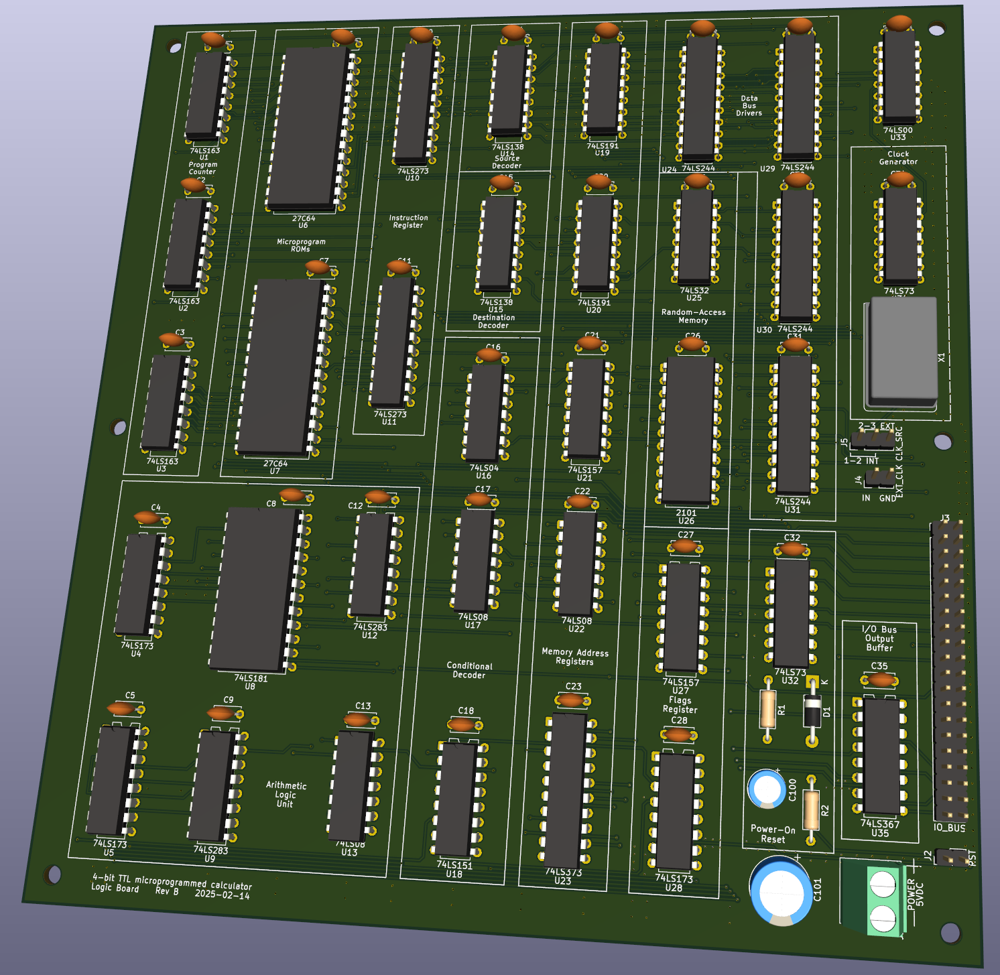
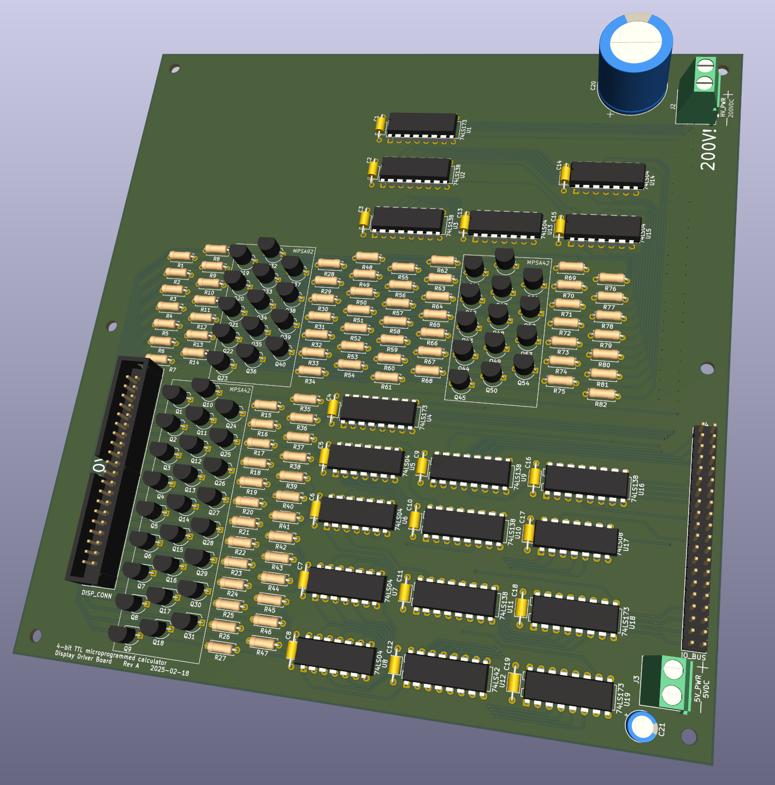
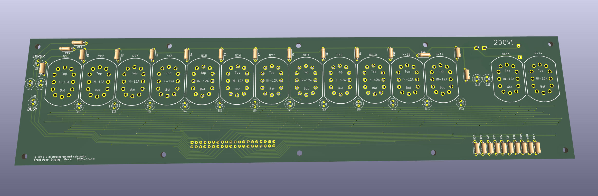

# TtlCalc2 Project

## Overview

The TtlCalc2 project is a recreation of the original (now TtlCalc1) project from 2005 that implemented a four-function floating point calculator in TTL logic without a microprocessor.

This version uses multilayer PCBs and Nixie tube and neon indicators for the display, whereas the original used wire wrap boards and LED 7-segment displays. Both versions share the same architecture, with separate (Harvard architecture) 8-bit data and 12-bit instruction address spaces, a 4-bit data path, and a 16-bit instruction word.

The goal of the original was to gain experience designing and implementing a processor with these techniques with an eye towards taking on the design of a more capable minicomputer. 

This repository contains the hardware and software components for the TtlCalc2 project, including simulation tools, assembly code, and documentation.

## Board renders

### Main logic board (processor)


### Display driver board


### Front panel display board (Nixies and neons)


## Directory Structure

 * [`hw/`](hw/): KiCad schematic and PCB designs for the hardware
 * [`sw/`](sw/): Software for the calculator (microinstruction ROMs)
 * [`doc/`](doc/): Design and implementation documentation
 * [`TtlCalcSim/`](TtlCalcSim/): Simulator for the calculator hardware

## Hardware

The [`hw`](hw) directory contains KiCad project files for the TtlCalc2 hardware design.

- [`ttlcalc2/`](hw/ttlcalc2/): Logic board hardware design files.
- [`ttlcalc2_display/`](hw/ttlcalc2_display/): Display driver module design files.
- [`ttlcalc2_front/`](hw/ttlcalc2_front/): Front panel design files.

TODO: The keyboard and keyboard interface still needs to be designed.

### Gerber Files

The `hw/ttlcalc2/gerbers` directory contains the Gerber files for PCB manufacturing.

## Software

The [`sw`](sw/) directory contains assembly code for the TtlCalc2 project. This project uses the [customasm](https://github.com/hlorenzi/customasm) assembler (v0.14.0 or later) to generate the microcode stream.

- [`ttlcalc2.asm`](sw/ttlcalc2.asm): Mnemonic definitions for the TtlCalc2 microcode.
- [`fib.asm`](sw/fib.asm): Assembly code for calculating Fibonacci numbers.

TODO: Port original ttlcalc assembly source code to new customasm syntax.

### Assembling

For example, to build the Fibonacci code, run:
```sh
customasm fib.asm
```
This generates `fib.bin` which you can then load into the simulator and run.

## Documentation

The [`doc`](doc/) directory contains documentation for the TtlCalc2 project.

## Simulation

The [`TtlCalcSim`](TtlCalcSim/) directory contains the simulation tools for the TtlCalc2 project. The simulator is implemented as a C#/.NET 9.0 console application.

- [`TtlCalcSim/`](TtlCalcSim/TtlCalcSim/): Core simulation library.
- [`TtlCalcSim.ConsoleUI/`](TtlCalcSim/TtlCalcSim.ConsoleUI/): Console-based user interface for the simulator.
- [`TtlCalcSim.Tests/`](TtlCalcSim/TtlCalcSim.Tests/): Unit tests for the simulation library.
- [`TtlCalcSim.Testing/`](TtlCalcSim/TtlCalcSim.Testing/): Helpers for testing assembly programs in the simulator.
- [`TtlCalcSim.ProgramTests/`](TtlCalcSim/TtlCalcSim.ProgramTests/): Tests that assemble programs from [`sw`](sw/) and run them in the simulator, including end-to-end checks of each instruction against the documented behavior.

### Building the Simulator

To build the simulator, open the TtlCalcSim.sln solution file in Visual Studio and build the project, or use the following command from the TtlCalcSim directory:
```sh
dotnet build
```

### Running Tests

To run the unit tests, use the following command from the TtlCalcSim directory:
```sh
dotnet test
```

The program tests assemble source at test time, so they need customasm v0.14.0 or later on `PATH`, or the `CUSTOMASM` environment variable set to its location.

### Testing programs

`TtlCalcSim.Testing` assembles a program with customasm and loads it into a `TestMachine`, which can set up state, run to labels, and inspect results by symbol name:
```csharp
var m = new TestMachine(AsmProgram.AssembleSw("fib.asm"));
m.RunUntil("numloop");                         // program labels; fails if the step limit is hit
Assert.Equal(0x1, m.Mem["src1h"]);             // memory by address or data label
m.RunToEnd(maxSteps: 10_000);
Assert.Equal(832040, m.ReadNumber(0xF8, 8));   // BCD, least significant digit first
```

`StartAt("label")` begins execution elsewhere, so a loop body can be tested in isolation after setting up memory and registers.

`AsmProgram.FromSource` assembles a snippet with the TtlCalc2 rules included, which is useful for testing individual instructions. I/O writes are recorded in `IoWrites`, and input is supplied with `QueueInput` or `OnInput`; reading an address with no input fails the test.

### Running the simulator

Either run the simulator executable after building, or run it via the `dotnet` command:
```sh
dotnet run --project TtlCalcSim.ConsoleUI
```

## License

This project is licensed under the MIT License. See the LICENSE file for details.
